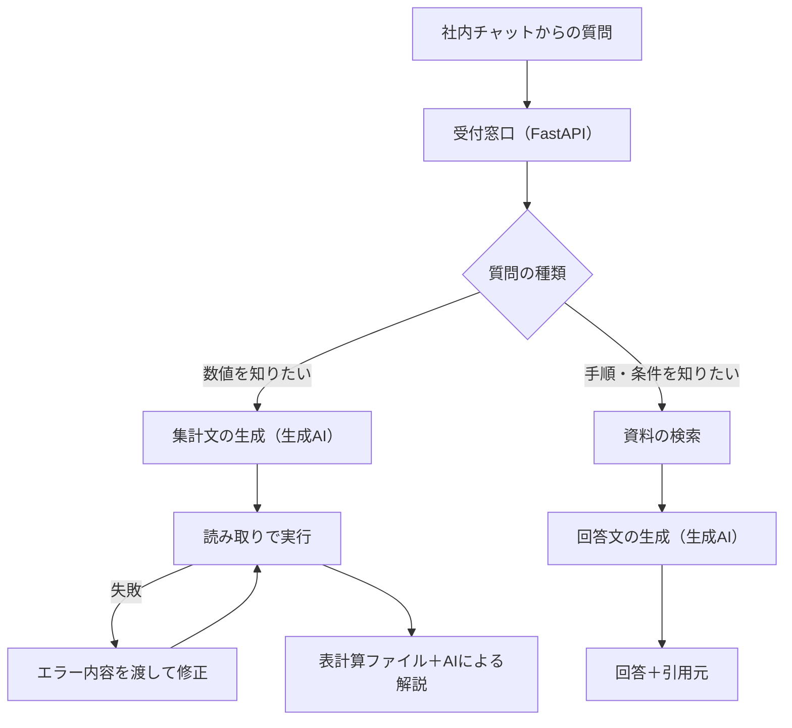

# 対話型分析と問い合わせ支援

生成AI（文章などを作る人工知能）を使い、普段の言葉による質問から集計結果と解説を作る機能と、業務資料を検索して問い合わせへの回答を作る機能。

## 利用者と課題

| 利用者 | 課題 |
|---|---|
| 分析担当・業務担当 | 数値を確認するたびに、データベースへの問い合わせ文（SQL）を書く必要がある。指標の定義が複雑で、書き方によって数値がずれる。 |
| 問い合わせ対応担当 | 回答に必要な手順や条件が、多数のマニュアル・過去の問い合わせ記録に分かれていて、探すのに時間がかかる。回答はほぼそのままお客様への案内に使われるため、食い違いが許されない。 |

## 全体の構成

## A. 質問からの集計（対話型分析）

### 処理の流れ

1. **質問の受付**：社内チャットからの依頼を受け取り、記号や宛先などの余計な部分を取り除く。
2. **下調べの問い合わせ**：本番の集計の前に、対象となる項目の実際の値を確かめる短い問い合わせを作って実行する。存在しない値を条件にする誤りを減らすため。
3. **集計文の生成**：生成AIに、次の情報を合わせて渡して問い合わせ文を作らせる。
   - 表の構造
   - 用語・指標の定義（用語集）
   - 正しく動くことが確かめられた集計の手本集
4. **実行と自動修正**：問い合わせ文を実行し、エラーが出たらエラー文をAIに渡して直させ、もう一度実行する。
5. **結果の返却**：結果は表計算ファイルにし、読み取れる傾向をAIが文章で解説して返信する。

### 精度を上げる工夫

| 工夫 | 内容 |
|---|---|
| 定義を明文化して渡す | 「新規客」「継続率」「期間ごとの累計購入額（LTV）」などの判定ルールを指示文に書く。AIが一般的な意味で推測すると、業務上の定義とずれるため。 |
| 手本に合わせる | 正しい集計の手本と似た依頼では、その構造に合わせて書かせる。 |
| 正解値と照合する | 管理画面で出した正解値を別に持ち、AIの集計結果と項目ごとに比べる。正解値は比較だけに使い、計算には混ぜない。 |
| ずれの原因を定義に戻す | 重複データの除外、初回注文の判定方法、期間で区切る集計の分け方など、ずれの原因を見つけたら定義として追記する。 |

## B. 資料検索に基づく回答（問い合わせ回答チャット）

RAG（資料を検索してから回答を作る方法）で動く回答チャット。既存の外部サービスを、自前の仕組みに置き換えるために作った。

### 資料の取り込み

| 資料 | 取り込み方 |
|---|---|
| PDF・表計算・文書・テキスト・Webページ | ページや行ごとに分けて索引（検索用の目録）に入れる。引用元としてページ番号も残す。 |
| 画像だけのPDF | 生成AIで文字に書き起こしてから索引に入れる。書き起こし結果は保存し、次回から使い回す。 |
| 問い合わせQ&A | 管理用の表計算シートの1行を1文書として入れる。シートを直すと、毎日の自動処理で索引に反映される。 |

資料ごとに内容の指紋（ハッシュ値）を記録し、変わった資料だけを入れ直す。起動のたびの二重登録や、全件の再計算を避けるため。

### 検索と回答の流れ

1. **2種類の検索を組み合わせる**：意味の近さで探す検索（ベクトル検索）と、言葉の一致で探す検索（BM25。日本語は単語に区切ってから使う）の順位を合成して、上位の資料を選ぶ。言い換えに強い検索と、商品名や数字などの固有の言葉に強い検索を両立させるため。
2. **Q&Aを必ず含める**：選んだ資料にQ&Aが決まった件数より少なければ、Q&Aだけを探して追加する。広い質問ではマニュアルのページばかりが上位に来て、回答の方向がずれたため。
3. **入力と資料の無害化**：AIへの指示を書き換えようとする文を取り除いてから渡す。
4. **回答の生成**：指示文で次のことを決める。
   - 資料にないことは答えない
   - 結論を先に書き、条件・数字を続ける
   - 当てはまるケースはすべて挙げる
5. **予備のモデル**：生成AIの呼び出しが失敗したら、再試行し、別のモデルに切り替えて答える。
6. **記録**：質問・回答・引用元・回答できたかを毎日記録し、管理用シートに転記する。答えられなかった質問は、新しいQ&Aを足す候補になる。

### 評価と改善

- **評価の基準**：既存サービスと同じ質問をして、回答を比べる。基準は「どちらが優れているか」ではなく、「結論・重要な数字や条件・大事な点の抜け」の3点が一致するかにした。現場の案内を混乱させずに置き換えるため。
- **改善の例**
  - 回答が長すぎる問題 → 結論を先に書く200〜300字の形に変更
  - 方向のずれる問題 → Q&Aを必ず含める仕組みを追加
  - 画像PDFが読めない問題 → 書き起こしを追加
- **確認の結果**：8問の比較で6問が一致した。残りの原因は、次のように切り分けた。
  - 既存サービス側の言葉の置き換え設定によるずれ
  - 必要なページが検索で15位にとどまり、AIに渡す上位10件に入らないこと

## 技術と役割

| 技術 | 役割 |
|---|---|
| Python（データ処理に使う言語） | 全体の処理 |
| FastAPI（処理を外部から呼び出す窓口を作る道具） | 質問の受付と回答の返却 |
| Gemini（生成AIのモデル） | 問い合わせ文・解説・回答の生成、文章の数値化（埋め込み）、画像PDFの書き起こし |
| LlamaIndex（資料の整理と検索を支える道具） | 資料の取り込み、索引、検索の組み合わせ |
| BM25（言葉の一致で順位を付ける検索方法） | キーワード検索 |
| PostgreSQL（表形式のデータ保存の仕組み） | 分析対象のデータ |
| Docker（動作環境をまとめて持ち運ぶ仕組み） | 開発と本番で同じ環境を動かす |
| 表計算シートのAPI（外部から操作する窓口） | Q&Aの管理と会話記録の転記 |

## 実装の例

[用語定義の管理](20261022-用語定義の管理.py)：業務用語の定義を保存し、問い合わせ文の生成に渡す補足文を作る部分。抜粋・変更した範囲は[収録方針](../20261022-収録方針と実装例.md)に記載。

## 紹介する範囲

集計の手本集の中身、学習用の実データ、会話記録、分析結果、問い合わせ資料の本文は含まない。

[全体案内に戻る](../20261022-はじめに.md)

## 元の実装から選んだファイル

[実装資料](20261022-実装資料)を参照してください。認証値・顧客データ等を除外しているため、全体をそのまま起動する構成ではありません。
