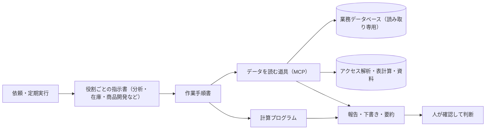

# 担当分担型の業務自動化

業務ごとに生成AIの担当（役割）と手順書を用意し、データを読む道具と計算プログラムを組み合わせて、報告・要約・計算・定期的な確認を行う仕組み。

## 利用者と課題

管理担当、業務担当、意思決定者が利用する仕組み。

日々の報告、資料探し、確認事項の整理、下書き作成が、複数の情報源にまたがっている。一つのAIに何でも任せると、参照先を間違えたり、数値を暗算で作ったりする。そこで、役割・手順・道具・計算を分けて、繰り返し同じ品質で行える形にする。

## 全体の構成

## 主な機能

| 機能 | 内容 |
|---|---|
| 役割ごとの指示書 | 分析・在庫・商品開発など、仕事ごとに参照先と作業範囲を決める。 |
| 作業手順書 | 報告や資料作成の手順と、確認事項をまとめる。 |
| データを読む道具 | MCP（AIが外部の道具を使うための共通の接続方式）で、管理画面の集計と同じ数値をAIが取り出せるようにする。 |
| 計算処理の分離 | 必要な発注数量、費用、期間の合計、前週比などは、プログラムで計算する。 |
| 定期的な実行 | 日次・週次の確認や報告を、決まった時刻に行う。 |
| 会話の要約 | 社内チャットの複数のグループの会話を、生成AIで毎日要約して文書にまとめる。 |

## 主な設計

### データを読む道具（MCP）

- データベースは読み取り専用の利用者で接続し、1回の問い合わせごとに「読み取りだけ」の取引で包んで、最後に取り消す。誤って書き換えることを防ぐため。
- 「誰が・いつ・何を呼んだか」は記録するが、返ってきた中身は記録しない。個人情報を記録に複製しないため。
- 管理画面の集計項目を道具として用意し、同じ条件で画面の数値と突き合わせて一致を確認した。
- 定型レポートは、従来の出力ファイルとこの道具の結果を並べて比べ、一致したことを確かめてから置き換える。

### 会話の要約（2段階の生成）

- 1段目でグループごとに話題を整理し、2段目で全体の要約を作る。一度にまとめるとグループや話題が抜け落ちたため。
- 休日は実行しない。実行時刻は日本時間で明示する（標準時のまま解釈され、9時間ずれる不具合があったため）。
- 生成AIの呼び出しが時間切れになったら再試行し、失敗をログに残す。

### 判断と計算を分ける

- AIには計算を暗算させない。数値は計算プログラムが出し、AIは判断材料と確認事項を文章にまとめる。
- 手順書、業務ルール、数値の正本（もとになる正しい資料）を分けて参照する。

## 処理の流れ

依頼・定期実行 → 役割の指示書を選ぶ → 手順に沿ってデータを取得 → 計算プログラムで数値化 → 根拠を確認 → 報告や下書き → 人が判断

この流れは説明用の要約です。実際の処理では、入力確認、権限確認、例外時の対応などが加わります。

## 技術と役割

| 技術 | 役割 |
|---|---|
| Markdown（見出しや表を書ける文書形式） | 役割の指示書と作業手順書 |
| JavaScript（Node.js：処理を書く言語と実行環境） | データを読む道具、計算、照合 |
| Python（データ処理に使う言語） | 集計、要約、資料作成の補助 |
| MCP（AIが外部の道具を使うための共通の接続方式） | 業務データ・アクセス解析・資料の参照 |
| Gemini・Claude（生成AIのモデル） | 要約、下書き、手順に沿った作業 |
| n8n（処理の流れを画面上でつなぐ道具） | 週次レポートなどの定期処理 |

## 実装の例

[発注数量と費用の計算](20261022-発注数量と費用の計算.mjs)：AIによる説明と数値計算を分ける例。抜粋・変更した範囲は[収録方針](../20261022-収録方針と実装例.md)に記載。

## 紹介する範囲

実際の担当者名、社内の意思決定の経路、会社資料の保存場所、実行予定、取引先への指示は収録していない。

[全体案内に戻る](../20261022-はじめに.md)

## 元の実装から選んだファイル

[実装資料](20261022-実装資料)を参照してください。認証値・顧客データ等を除外しているため、全体をそのまま起動する構成ではありません。
