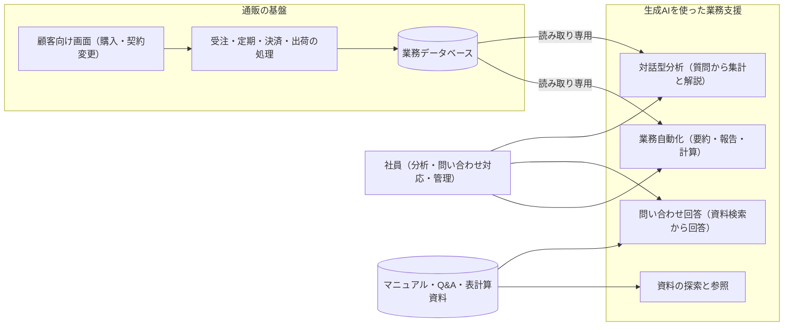

# システム構築実績

作成者：立川

通販事業を支えるシステム全体を、6つの仕組みに分けて紹介します。
土台となる通販の基盤と、その上で生成AI（文章などを作る人工知能）を使って分析・問い合わせ対応・定型業務を支える仕組みが、どうつながり、どう作られているかをまとめました。

## 全体の構成

| 層 | 役割 | 対応する仕組み |
|---|---|---|
| 通販の基盤 | 購入から出荷までの業務を処理し、データを保存する | 01・02・03 |
| 生成AIの応用 | 保存されたデータと業務資料を、質問や定型作業から使えるようにする | 04・05 |
| 情報源の整理 | AIと人が正しい資料にたどり着くための案内と読み取り方法 | 06 |

## まず読むところ

| 仕組み | 解決すること | 資料 |
|---|---|---|
| 対話型分析と問い合わせ支援 | 普段の言葉による質問から集計結果と解説を作る機能と、業務資料を検索して問い合わせへの回答を作る機能。 | [説明を読む](20261022-04対話型分析と問い合わせ支援/20261022-仕組みと設計.md) |
| 担当分担型の業務自動化 | 業務ごとのAIの担当と手順書、データを読む道具、計算プログラムを組み合わせ、報告・要約・計算・定期確認を行う仕組み。 | [説明を読む](20261022-05担当分担型の業務自動化/20261022-仕組みと設計.md) |
| 業務資料の探索と参照支援 | 必要な資料の場所を案内し、大きな表から必要な範囲だけを読み取る仕組み。 | [説明を読む](20261022-06業務資料の探索と参照支援/20261022-仕組みと設計.md) |
| 定期通販の新基盤 | 購入、定期契約、決済、出荷、顧客対応を一つの管理基盤にまとめ、旧通販から新しい土台へ移した仕組み。 | [説明を読む](20261022-01定期通販の新基盤/20261022-仕組みと設計.md) |
| 旧通販の顧客向け機能 | 購入申込、会員向け画面、定期契約の変更、継続・解約の案内を提供する仕組み。 | [説明を読む](20261022-02旧通販の顧客向け機能/20261022-仕組みと設計.md) |
| 旧通販の管理と自動処理 | 受注管理、定期受注、決済後の処理、出荷、集計を支える社内向けの仕組み。 | [説明を読む](20261022-03旧通販の管理と自動処理/20261022-仕組みと設計.md) |

## システム全体で共通する設計の考え方

### 1. 数値はプログラム、説明は生成AI

売上や継続率などの数値は、データベースへの問い合わせや計算プログラムで求める。生成AIは、問い合わせ文の作成、結果の解説、要約、回答文の作成に使う。AIが数値を推測で作らないようにするため。

### 2. 正解と照合して精度を確かめる

AIの出力は「それらしいか」ではなく、管理画面の集計値や既存の回答など、あらかじめ決めた正解と突き合わせて確認する。ずれた場合は、検索・指示文・定義のどこが原因かを切り分けて直す。

### 3. AIに渡す情報を設計する

精度の改善は、モデル自体の追加学習ではなく、AIに渡す情報の工夫で行う。用語や指標の定義、正しい集計の手本、検索で選ぶ資料の種類と件数を調整する。

### 4. 安全に読み、止まらずに動かす

AIがデータを読むときは読み取り専用の権限を使う。秘密の値は設定ファイルに分け、収録しない。AIの呼び出しが失敗したときは、再試行や予備のモデルへの切り替えで処理を続ける。

## 6つの関係

| 関係 | 意味 |
|---|---|
| 顧客向け機能と管理処理 | 購入者の操作と、その後の受注・決済・出荷をつなぐ |
| 旧通販と新基盤 | 既存の業務条件を整理し、新しい土台で同等の結果を確認する |
| 通販と分析支援 | 保存された数値を、質問から参照しやすくする |
| 業務自動化と資料探索 | 作業手順と情報源を用意し、報告や判断材料の作成を助ける |

## 実装を読む

[実装の収録案内](20261022-実装の収録案内.md)から、元の実装から選んだファイルへ進めます。収録の考え方は[公開用の収録方針](20261022-公開用の収録方針.md)にまとめています。
